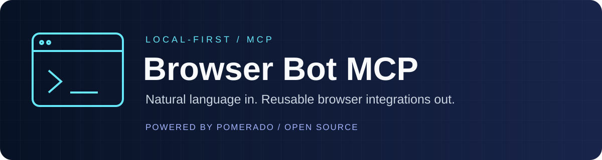

<div align="center">



[](LICENSE)


**Describe a web task once. Replay the integration locally.**

[Quick start](#install) · [MCP setup](#add-it-to-your-mcp-client) · [Tools](#the-tools) · [Architecture](#how-it-works)

</div>

> [!WARNING]
> Experimental safety checkpoint. Use only public, non-sensitive read tasks. Write authorization, credential handling and real-browser validation are not production-ready.

`browser-bot` is a local [MCP](https://modelcontextprotocol.io) server that gives an agent one
capability: **do a task on a website**. You give it a URL and the task in plain language. The
first time it meets a site it builds a small, deterministic integration for that task with
[Pomerado](https://github.com/Pomerado/pomerado); afterwards it replays that integration, with
no model, no key and no computer-use guesswork.

```
browser_do { url, task }  ──►  mint once (explores the site in Chromium, asks questions)
                          └──►  run forever (deterministic replay, returns typed JSON)
```

That is the whole idea, and it is the point of Pomerado: a browser agent that re-decides every
step is slow, expensive and flaky on the fifth run. A saved integration clicks the same things
in the same order every time, and its source is on disk for you to read.

Local components: the minter, the browser, the saved integrations. No Pomerado account is needed.
Minting calls OpenAI, so it needs `OPENAI_API_KEY`; running an integration does not.

---

## What it is designed to do

| Capability | Status |
|---|---|
| Read public pages, search results and tables | Intended read-only use |
| Mint and replay task-specific integrations | Real Pomerado validation pending |
| Forms, purchases and other writes | Disabled in the intended safety configuration; enforcement requires verification |
| Authentication and one-time codes | Not recommended until secret handling is validated |
| CAPTCHA bypass | Not supported |

Each mint has a 20-minute active-work budget. Reuse must be scoped to the URL, task and authority.

---

## Install

1. **Node 24.21 or later in Node 24** — Pomerado's requirement. The bot itself runs on Node 20+,
   but it starts Pomerado, so the whole chain needs the newer Node.
2. **Pomerado and its Chromium**:

   ```sh
   npx -y -p pomerado pomerado-mcp --help
   npx -y -p pomerado playwright install chromium
   # on Linux, if Chromium's system libraries are missing:
   npx -y -p pomerado playwright install --with-deps chromium
   ```

3. **An OpenAI key** for minting, in the server's environment, never in chat:

   ```sh
   export OPENAI_API_KEY=sk-...
   ```

4. **This package's dependencies**:

   ```sh
   npm install
   ```

Then check the whole chain at once:

```sh
node bin/browser-bot.mjs doctor
```

```
Integration root: /home/you/browser-bot/integrations
ok   node: Node 24.21.0.
ok   integration_root: Integrations are saved under /home/you/browser-bot/integrations.
ok   model_key: OPENAI_API_KEY is set in the bot's environment; minting can call the model.
ok   pomerado: npx -y -p pomerado pomerado-mcp answers --help.
ok   chromium: Chromium is installed in /home/you/.cache/ms-playwright.

Ready to mint and run.
```

`doctor` also tells you the one line that fixes each `FAIL`.

---

## Add it to your MCP client

The server is a stdio MCP server. Use an **absolute** path for the script and for
`BROWSER_BOT_ROOT`, because clients start servers from their own working folder.

```json
{
  "mcpServers": {
    "browser-bot": {
      "command": "node",
      "args": ["/absolute/path/to/browser-bot-mcp/bin/browser-bot.mjs"],
      "env": {
        "OPENAI_API_KEY": "sk-...",
        "BROWSER_BOT_ROOT": "/absolute/path/to/browser-bot/integrations"
      }
    }
  }
}
```

| Client | Command |
|---|---|
| Claude Code | `claude mcp add browser-bot -- node /abs/path/bin/browser-bot.mjs` |
| Codex | `codex mcp add browser-bot -- node /abs/path/bin/browser-bot.mjs`, then add `env_vars` |
| Gemini CLI | `gemini mcp add -s user -e OPENAI_API_KEY=$OPENAI_API_KEY browser-bot node /abs/path/bin/browser-bot.mjs` |
| Cursor / VS Code / Claude Desktop | the `mcpServers` entry above, in their own config file |

Ask your client which tools it has: it should list `browser_do`, `browser_mint`, `browser_run`,
`browser_list`, `browser_describe`, `browser_forget`, `get_job`, `provide_input`, `cancel_job`
and `browser_doctor`.

---

## Use it

In your agent:

> Read the title and price of the first result on https://books.example.com/search?q=rust

The agent calls `browser_do`. The first call mints, which takes minutes and may ask questions:

```
job_status: input_required
pending_input:
  notice: The site offers a choice of country.
  questions:
    - id: country    type: choice    prompt: Which store should I use?
      options: [{id: fr, label: France}, {id: us, label: United States}]
```

Answer with `provide_input`, then `get_job`:

```
job_status: completed
output: { title: "Programming Rust", price: "€39.90" }
integration: { integration: books_example_com, authority: read, directory: … }
```

A matching saved integration is intended to replay without a model call. Do not use write tasks in this checkpoint.

### The tools

| Tool | What it does |
|---|---|
| `browser_do` | The one call: reuse or mint the integration for the site, then run the task. Best first choice |
| `browser_mint` | Build an integration without running it |
| `browser_run` | Run an existing integration with an explicit `input` |
| `browser_list` | What is installed, with site, authority and task |
| `browser_describe` | One integration's input/output schema and the questions a run may ask |
| `browser_forget` | Move an integration into `<root>/.archive` (nothing is deleted) |
| `browser_doctor` | Check Node, Chromium, Pomerado, the root and the key |
| `get_job` | Observe a job. Never restarts work, never repeats a website action |
| `provide_input` | Answer a job's questions, keyed by question id |
| `cancel_job` | Stop a job and close its browser |

The three `browser_*` work tools return a job view at once, or the finished result when it
lands within `wait_seconds` (default 20). A failed job returns an error result. Structured write-status propagation still requires validation.

### The command line

The same bot, for a human at a terminal — handy for a first try and for `doctor`:

```sh
node bin/browser-bot.mjs do --url https://example.com --task "read the main heading"
node bin/browser-bot.mjs list
node bin/browser-bot.mjs describe example_com
node bin/browser-bot.mjs run example_com --input '{"query":"rust"}'
```

Questions are asked on the terminal, in the answer shapes Pomerado expects; a password is read
with echo off.

---

## Safety and privacy

- Use public, non-sensitive read tasks only until authorization enforcement is verified.
- Never send passwords or one-time codes through chat or MCP tool arguments.
- Pin a reviewed Pomerado version before installing or executing it.
- Keep API keys in the local environment, not in committed configuration.
- Do not retry an uncertain external action automatically.

## How it works

```
browser-bot (this MCP server)
   │  browser_do
   ├── matching URL, task and authority?  ── yes ─► run it
   │                                          (spawn `pomerado-mcp serve --artifact <dir>`)
   └── no ─► mint it
              (spawn `pomerado-mcp mint --root <root>`, follow the job, relay its questions)
```

| File | Role |
|---|---|
| `src/server.mjs` | MCP server: tool list, dispatch, graceful shutdown |
| `src/tools.mjs` | Tool schemas, argument checks, the write-approval gate |
| `src/flows.mjs` | Mint, run, and the reuse-or-mint decision; job following |
| `src/jobs.mjs` | Job store: start, observe, answer, cancel, timeouts, limits |
| `src/child.mjs` | Supervised MCP child process (minter or integration server) |
| `src/integrations.mjs` | Reading the integrations folder, archiving, describing |
| `src/config.mjs` | Environment, the Pomerado command, the roots |
| `src/doctor.mjs` | The readiness check |
| `src/answers.mjs`, `src/cli.mjs`, `bin/` | The command line |

The bot talks to Pomerado as an MCP client, so a child's logs cannot corrupt its own protocol
stream, and a new Pomerado release does not change the bot's contract.

### Configuration

| Variable | Default | Meaning |
|---|---|---|
| `BROWSER_BOT_ROOT` | `~/browser-bot/integrations` | Where integrations are saved (absolute) |
| `BROWSER_BOT_POMERADO` | `npx -y -p pomerado pomerado-mcp` | Command that runs `pomerado-mcp`; use a global install for a stable path |
| `BROWSER_BOT_POMERADO_VERSION` | `pomerado` | Package spec for the default npx command (pin a version here) |
| `BROWSER_BOT_RUN_MODE` | `pomerado-mcp` | `pomerado-mcp`: ask your Pomerado to serve the folder. `launcher`: replay the integration's `mcp.json` |
| `BROWSER_BOT_WAIT_MS` | `20000` | Default `wait_seconds` for a work tool, 0–30000 |
| `BROWSER_BOT_MAX_JOBS` | `2` | Concurrent jobs, 1–8 |
| `BROWSER_BOT_MINT_TIMEOUT_MS` | `1200000` | Budget for one mint |
| `BROWSER_BOT_RUN_TIMEOUT_MS` | `600000` | Budget for one run |
| `OPENAI_API_KEY` | — | Read by the minter. Running an integration never needs it |

### Notes and limits

- Jobs live in the bot's process: restarting the client ends them. A write that may have landed
  stays unconfirmed, which is why the bot never replays one.
- A mint costs model tokens and takes minutes; a replay does not require model tokens. Prefer `browser_run` once an
  integration exists, and `browser_do` when you are not sure it does.
- Reuse is intended to match URL, task and authority; regression validation is pending.
- The integration folder names its own runtime, which is why `BROWSER_BOT_RUN_MODE=pomerado-mcp`
  is the default: a cached `npx` install can move without breaking your saved integrations.

## Tests

```sh
npm test
```

The suite runs the real bot over stdio against a stand-in for `pomerado-mcp`
(`test/fixtures/fake-pomerado-mcp.mjs`) that speaks the same MCP protocol and job vocabulary:
mint asks a question, publish writes a folder, run answers. No browser, model or network is
involved, so the tests cover the bot's orchestration — reuse, mint, questions, cancellation,
authority, archiving — in about three seconds.

## Credit

Pomerado is MIT-licensed, by Pomerado AI, Inc. This package only orchestrates it: all the browser
work, the Guardian review and the integration runtime are theirs. See
[github.com/Pomerado/pomerado](https://github.com/Pomerado/pomerado) and
[docs.pomerado.ai](https://docs.pomerado.ai).

## Local safety checkpoint

The intended safety policy disables writes and artifact launchers and scopes reuse to URL, intent and effect. Enforcement still requires regression validation. Full MCP and real Pomerado tests are pending dependency installation. This is not a production release.
